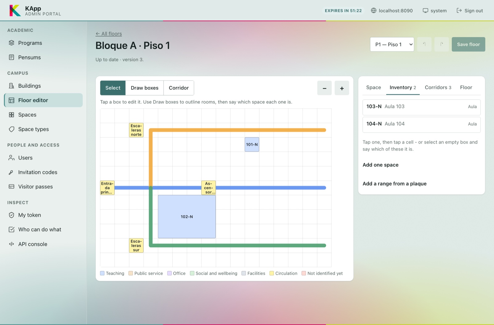
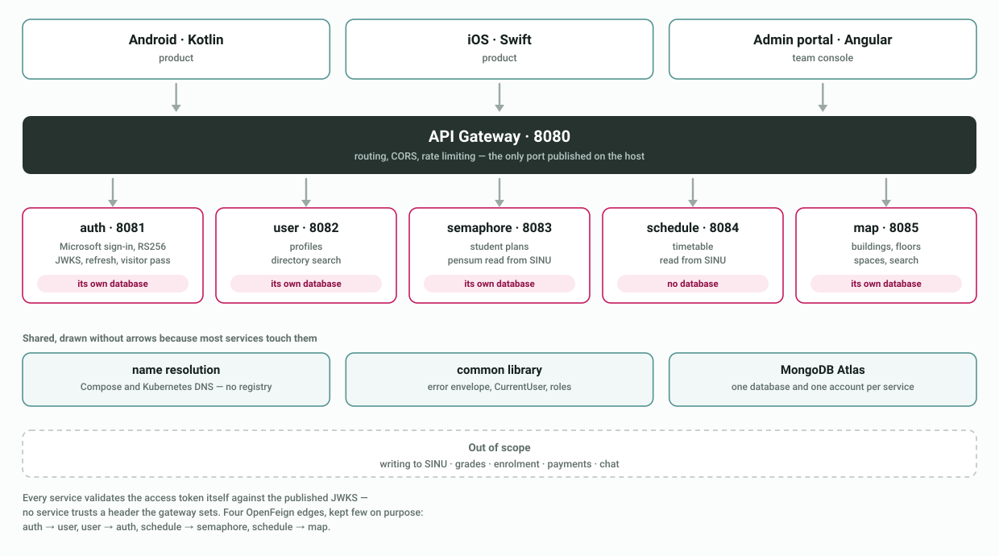

<a id="top"></a>

<table width="100%" style="border: none; background-color: transparent;">
  <tr style="border: none; background-color: transparent;">
    <td align="center" width="20%" style="border: none; padding: 0;">
      
    </td>
    <td align="center" width="80%" style="border: none; padding: 0;">
      
    </td>
  </tr>
</table>

<p align="center"><strong>University mobile app for Fundación Universitaria Konrad Lorenz. Native Android (Kotlin) and iOS (Swift) clients, powered by a Spring Boot microservices backend on MongoDB, with RS256 tokens verified by every service.</strong></p>

<p align="center">
  <a href="https://github.com/K-Forge/KApp/actions/workflows/ci.yml"></a>
  &nbsp;
  <br/><br/>
  
  
  
  
  
  
  
  
</p>

---

## Table of Contents

- [Overview](#overview)
- [Project Status](#project-status)
- [Interface](#interface)
- [System Architecture](#system-architecture)
- [Key Features](#key-features)
- [Tech Stack](#tech-stack)
- [Getting Started](#getting-started)
- [Project Structure](#project-structure)
- [Documentation](#documentation)
- [Security](#security)
- [Contributing](#contributing)
- [Contributors](#contributors)
- [License](#license)

---

## Overview

KApp is the **university mobile application** for the Fundación Universitaria Konrad Lorenz community, developed by
the K-Forge development club as a thesis project. It shows a student their timetable, their progress through their
pensum and the campus map, and gives the community notifications, a student voice, damage reports and lost and found.

**KApp reads SINU, the university's academic system, and never copies it.** The timetable, the catalogue, pensums
and course statuses are read from SINU, read-only; nothing academic is stored, and a student only edits their own
plans. Until the university opens SINU, a test adapter serves invented data with its shape. Members sign in with
their university **Microsoft** account. Editing grades, enrolment, payments and chat are out of scope; see
[`docs/SRS.md`](docs/SRS.md) and [`docs/SINU-ALIGNMENT.md`](docs/SINU-ALIGNMENT.md).

The clients are thin. Everything they consume lives **server-side**: independent Spring Boot services behind a
single API Gateway, which address each other by name with no registry. **Every service validates the access token
itself** against a published JWKS rather than trusting a header the gateway sets, and each service that stores data
holds its own MongoDB account with `readWrite` on exactly one database — so the separation between services is
enforced by the engine, not merely respected by the code.

Delivery goes **straight to mobile**. There is a web portal, but it is an administration and development console
for the team — not a product surface. The mobile clients are unblocked: the OpenAPI contracts are served as
Prism mocks, so Kotlin and Swift work does not wait on the backend.

---

## Project Status

KApp is a **degree thesis project**. Brian hands in the thesis proposal at the end of the 2026-2 term, and the
product is presented in **2027-2**. Backend: Brian. Android: Iván, Alejandro and Santiago. iOS: Brian.

What that means when reading this repository:

- **The contracts are the interface.** The 2.0 set — semaphore 2.0, schedule 2.0, auth 1.0, user 1.0, map 3.6 —
  is in [`docs/api/`](docs/api/), with its history in [`docs/api/CHANGELOG.md`](docs/api/CHANGELOG.md), and is
  served as Prism mocks, so the clients never wait on the backend.
- **The backend is built in phases**, one issue each. Phase 1 removed the Eureka registry and two frozen services;
  phase 2 made the academic data read-only, behind the test SINU adapter; phase 3 is under way — rotating refresh
  tokens and development-only password sign-in are in, and Microsoft sign-in and the new roles come next. Kubernetes, notifications and the community features follow.
  [`docs/PROGRESS.md`](docs/PROGRESS.md) has the detail.
- **The Android app is under way**: sign-in, home, profile, semáforo with plans, and timetable, built against the
  mocks. The iOS app is in progress.
- **There is no production deployment yet.** A development server follows `develop`; production hardware is agreed
  with the university's IT director, and the backend is moving to Kubernetes. See [Security](#security).
- **The development database is a shared Atlas cluster, and the only one.** It holds one database per service that
  stores data, each with its own account, so the whole team works against the same data and nobody installs a
  server. There is no local MongoDB to fall back to — the stack needs the network
  ([ADR 0009](docs/adr/0009-atlas-is-the-only-development-database.md));
  [`docs/ONBOARDING.md`](docs/ONBOARDING.md) is the setup a teammate follows.
- **What is still blocked, and on whom**, is listed in [`docs/PROGRESS.md`](docs/PROGRESS.md) — access to SINU, an
  Entra ID application registration, the floor sketches, and an Apple Developer account for iOS push.
- The original Spring Boot monolith was removed once the migration completed. It remains retrievable
  from the git history; `app/backend/microservices/` is the only backend.

---

## Interface

**The apps are being built**, and their screenshots will come with the first release; showing mockups here as if
they were shipped would be the wrong impression to leave. What can be shown today is the portal the team uses to
build them, floor editor included.

### The floor editor

This is how a floor of the campus gets drawn: from the evacuation plan and the information plaques
photographed in the survey ([`docs/map/LEVANTAMIENTO.md`](docs/map/LEVANTAMIENTO.md)), then
corrected standing in the floor itself. It is a screen of the admin portal, built for an iPad —
outline the rooms the plan draws, load the rooms the plaque lists (a range like "401 a 410" at
once), say which box each one is, trace the corridors in the colour they are painted.

It matters more than a tool usually would. The map used to be modelled as a photograph of an
architectural plan, and obtaining those plans depended on other people's calendars — it was the
project's longest-lead item and the one most likely to slip. A schematic floor is
drawn in an afternoon by the people who need it.
[ADR 0006](docs/adr/0006-schematic-map-not-floor-plan-images.md) records the trade.

<p align="center">
  
  <br/>
  <sub>Floor 1 of Bloque A, from the placeholder campus. Boxes are coloured by category; the lifts,
  stairs and entrance are what "reached via" points at, which is what lets the app say "sube por el
  ascensor central". Aulas 103-N and 104-N are known to be on the floor but not drawn yet, so they
  wait in the inventory. The whole floor is saved at once, and refused if somebody else saved it
  first; until then the changes stay on the device.</sub>
</p>

Open it at http://localhost:4300/data/floors.

### The admin and developer console

An Angular portal at `localhost:4300`: CRUD over programs, pensums, users, buildings, spaces,
invitation codes and visitor passes; a paste-and-correct importer that turns a pensum PDF into a
catalogue entry; an API console driven by the OpenAPI specs themselves, which explains every field
of a response from the contract; and a role inspector showing what each role may reach. It is a **team console, not a
product surface** — nothing a student ever sees.

```bash
cd app/backend/microservices && docker compose --profile core --profile dev up -d
```

### The 2025 prototype

An earlier plain HTML/JS client showed courses, assignments and grading, none of which KApp builds. It was deleted
in October 2026, together with its public demo and the legacy PostgreSQL schema (#51); git keeps both. A better
public demo, showing the real apps with invented data, is planned (#92).

---

## System Architecture

The mobile clients run on the user's device; every service runs server-side. **The gateway is the only reachable
component** — service ports are deliberately unpublished — and services address each other by name, which Docker
Compose and Kubernetes resolve, with no registry.

<p align="center">
  
</p>

Two properties are worth stating in words, because a box does not carry them:

**No service trusts the gateway.** Each one validates the access token itself against the published
JWKS, so a request that somehow reached a service directly is refused by that service rather than
by the boundary it went around — that gap was security finding S1.

**One MongoDB account per service that stores data, with `readWrite` on exactly one database.** The separation is
enforced by the engine rather than respected by convention, and `scripts/verify-db-isolation.sh`
asserts it by connecting with each account against every database
([ADR 0005](docs/adr/0005-per-service-database-credentials.md)).

---

## Key Features

- **Single entry point.** All client traffic goes through the gateway, whose routes are declared explicitly against
  each service's address (`kapp.services.*`). There is no registry and no discovery-based exposure, so nothing
  becomes routable by accident.
- **Per-service token validation.** Every service is an OAuth2 resource server verifying RS256 against a published
  JWKS. Identity comes from the signed token, never from a header.
- **Authorization asserted, not assumed.** Every endpoint carries an explicit rule, and each service's full
  role-by-endpoint matrix is asserted in tests — **including every combination that must be refused**, which are the
  ones that matter.
- **Database isolation the engine enforces.** One database *and one account* per service, each with `readWrite` on
  exactly one. `scripts/verify-db-isolation.sh` proves it in 25 checks.
- **Contract-first.** Five hand-written OpenAPI 3.1 specs, linted in CI and served as Prism mocks on one port, so
  the mobile clients are never blocked on the backend.
- **Academic data read, never stored.** SINU is read through an adapter; a test adapter serves invented data until
  the university opens it.
- **Versioned migrations.** Mongock change units are ordered, audited and lock-protected, so several developers and
  CI can point at one database without racing.
- **Integration tests on Testcontainers**, from a repository that had none in August 2026.
- **A campus map drawn from the university's plans.** Floors are polygons traced from the evacuation plans and
  checked on site, not photographs of architectural drawings.

---

## Tech Stack

| Technology | Role | Why this one |
| --- | --- | --- |
| Kotlin (Android) | Primary client | The product's main delivery target. |
| Swift (iOS) | Primary client | Consumes the same gateway API as Android. |
| Java 21 | Backend language | Long-term support release. |
| Spring Boot **3.5** | Service runtime | **Not Boot 4**: Mongock publishes no Boot 4 artifact. |
| Spring Cloud **2025.0** | Distributed layer | The release train for Boot 3.5; 2025.1.x targets Boot 4. |
| Spring Cloud Gateway | Edge routing | One entry point, with an explicit routing table rather than discovery-based exposure. |
| Compose and Kubernetes DNS | Service addressing | By name, with no registry: Eureka was removed in October 2026. |
| Spring Security 6.5 (OAuth2 resource server) | Authorization | **RS256** with a published JWKS. A shared symmetric secret handed to every service is that many places that can mint an admin token. Members sign in with Microsoft Entra ID; auth-service verifies that sign-in and issues KApp's own tokens, so the other services never change. |
| OpenFeign | Inter-service calls | Four edges, kept few on purpose. New features cross services through a transactional outbox instead. |
| Spring Data MongoDB | Persistence | Document-shaped aggregates with a single writer each. See [ADR 0001](docs/adr/0001-mongodb-over-postgresql.md). |
| **Mongock 5.5.1** | Migrations | Versioned, ordered, audited change units with a distributed lock — which the project previously had none of. |
| MongoDB Atlas 8 | Database | One engine, not polyglot ([ADR 0004](docs/adr/0004-one-database-engine-not-polyglot.md)), and one cluster, shared, with no local alternative ([ADR 0009](docs/adr/0009-atlas-is-the-only-development-database.md)). The tests are the exception: Testcontainers starts them their own, because a test run has to be free to wipe its data. |
| Testcontainers | Testing | Real MongoDB per suite; no in-memory substitute pretending to be a database. |
| OpenAPI 3.1 + Prism | Contracts | Hand-written, linted in CI, served as mocks so client work never waits. |
| Maven (multi-module) | Build | The parent POM centralises every version, so parallel branches never edit it. |
| Docker + Docker Compose | Containerisation | Profiles (`mock`, `core`, `academic`, `map`, `full`, `dev`) so a laptop runs only what is needed. |
| Kubernetes (kind) | Deployment | In scope: locally with kind and in production, backend phase 6. |
| Angular 22 + Vitest | Admin portal | A team console, not a product surface. |
| pnpm | Tooling | Repository tooling and the portal's dependencies. |

---

## Getting Started

**Docker Desktop and pnpm are both required**, and Docker has to be *running*, not just installed —
every service and the tests' own database live in containers, and the development database is the shared
Atlas cluster. Nothing else is:
there is no MongoDB to install, no Maven (the repository ships `./mvnw`) and no JDK unless you
intend to build outside Docker.

**The same commands work on Windows and macOS.** They are single `docker compose` invocations with
no shell syntax in them, so it makes no difference which shell pnpm hands them to.

```bash
git clone https://github.com/K-Forge/KApp.git
cd KApp
corepack enable && pnpm install

# Secrets are generated on your machine, never copied from an example: a password that
# passes through a chat or a commit stays in that history forever.
cd app/backend/microservices && ../../../scripts/generate-dev-secrets.sh > .env && cd -

pnpm run microservices:start     # the five services, the gateway and the portal
pnpm run microservices:status    # what came up
```

There is nothing to initialise afterwards. Mongock creates every index and loads the seed data —
pensums, buildings, spaces, invitation codes — the first time a service starts.

The profiles, what listens on which port, the development accounts, and what to do when something
will not start are all in
**[`docs/RUNBOOK.md`](docs/RUNBOOK.md)**. It is the operational document; this section is only the
shortest path to a running stack.

### Available scripts

| Command                         | Description                                                               |
| ------------------------------- | ------------------------------------------------------------------------- |
| `pnpm run microservices:start`  | Starts the five services, the gateway and the admin portal.               |
| `pnpm run microservices:mock`   | Prism mocks only — no JVM, no database. For client work.                  |
| `pnpm run microservices:status` | Shows what is running.                                                    |
| `pnpm run microservices:logs`   | Follows the logs. Add `-- <service>` for one of them.                     |
| `pnpm run microservices:stop`   | Stops everything, mocks and portal included.                              |

The admin portal has its own scripts, in `app/frontend/web-admin/package.json`, because they are
its build and not the repository's: `pnpm start`, `pnpm build`, `pnpm test`.

These are thin wrappers around `docker compose`, and deliberately so: **they work the same on
Windows and macOS**. They pass the compose file by path rather than changing directory first,
because `pnpm` runs scripts through `cmd.exe` on Windows and `sh` elsewhere, and the two do not
agree about `cd` with forward slashes. Nothing in them is shell-specific.

### Building a client against this

The backend is ready to be built against. Two ways in, and the choice is about what you are doing
rather than which is better:

**Against the contracts.** `docker compose --profile mock up -d` serves the five OpenAPI specs as
Prism mocks, all on `http://localhost:4000` (and one per service on 4010–4014). Every endpoint answers with the examples in the contract, immediately, with no
database and no sign-in. This is the one to use while a screen is being laid out.

**Against the real services.** `docker compose --profile core up -d` starts the
services against the shared Atlas cluster — real data, real tokens, real 403s. Ask Brian for the
`.env`; [`docs/ONBOARDING.md`](docs/ONBOARDING.md) is the walkthrough.

Either way the interface is the same and it is in [`docs/api/`](docs/api/), not in this README:

- **Everything goes through the gateway on `:8080`.** Service ports are unpublished on purpose.
- **Members sign in with Microsoft.** In auth 1.0 the app sends the Microsoft ID token to `POST /auth/microsoft` and
  gets KApp's RS256 access token; send it as `Authorization: Bearer <token>`. It lasts an hour, and
  `POST /auth/refresh` renews it (#82). Microsoft sign-in is the rest of backend phase 3; until it lands, and in
  development only, `POST /auth/login` signs in with a password. A `401` means "send the user back to sign-in" — the Auth contract
  says so in the spec rather than leaving you to find out.
- **Every error has the same shape**: `timestamp`, `status`, `error`, `message`, `path`, and
  `details` when a field is at fault. Bind your form errors to `details`; show `message` to a person.
- **`x-roles` on every operation** says which roles may call it, written from what the services
  actually enforce. The portal's "Who can do what" screen renders the same data if you would rather
  read it as a table.

---

## Project Structure

```
KApp/
├── app/
│   ├── backend/
│   │   └── microservices/            # The backend — Maven multi-module project
│   │       ├── api-gateway/          # Routing, CORS, rate limiting (:8080) — the only open port
│   │       ├── auth-service/         # Microsoft sign-in, RS256 tokens, JWKS, refresh, visitor passes (:8081)
│   │       ├── user-service/         # Profiles and directory search (:8082)
│   │       ├── semaphore-service/    # Student plans; catalogue and progress read from SINU (:8083)
│   │       ├── schedule-service/     # Timetable read from SINU, no database (:8084)
│   │       ├── map-service/          # Buildings, polygon floors, spaces, search (:8085)
│   │       ├── common/               # Error envelope, CurrentUser, role constants
│   │       ├── mock/                 # Prism mocks behind one port
│   │       ├── docker-compose.yml    # Profiles: mock, core, academic, map, full, dev
│   │       └── pom.xml               # Parent POM — every version lives here
│   └── frontend/
│       ├── web-admin/                # Admin and developer console (Angular 22)
│       └── mobile/
│           ├── kotlin/               # Android client — the product, in progress
│           └── swift/                # iOS client — the product, in progress
├── deploy/dev-server/                # The development server: compose and the agent that follows a branch
├── docs/
│   ├── api/                          # Five OpenAPI 3.1 contracts — the source of truth — and their CHANGELOG
│   ├── adr/                          # Architecture decision records
│   ├── map/                          # The campus survey and the plans the floors are drawn from
│   ├── pensums/                      # The published plans: transcriptions, extraction tools, seed builder
│   ├── templates/                    # The pensum import CSV and its column reference
│   ├── PROGRESS.md                   # What is built, and what is blocked on whom
│   ├── RUNBOOK.md                    # How to start, stop and troubleshoot it
│   ├── SINU-ALIGNMENT.md             # What KApp reads from SINU, and what it must never store
│   ├── SECURITY-AUDIT.md             # Findings and what closed each
│   ├── SRS.md · REQUIREMENTS.md · DESIGN.md  # What KApp is, its requirements and its architecture
│   └── ATLAS-SETUP.md                # Standing up the shared development cluster
├── scripts/
│   ├── generate-dev-secrets.sh       # Writes .env — secrets never leave the machine
│   ├── create-dev-accounts.sh        # The team accounts
│   ├── verify-db-isolation.sh        # Proves each service reaches its own database and no other
│   ├── verify-visitor-pass.py        # End-to-end check of the day pass through the gateway
│   ├── check-git-conventions.sh      # The contributing rules as code, run by CI and the commit hook
│   └── restack.sh                    # Rebases the pull requests stacked on a squash-merged one
├── .github/
│   ├── CODEOWNERS                    # The lead reviews every path
│   └── workflows/                    # CI, conventions, dev images and restack
├── CONTRIBUTING.md                   # Git Flow and commit rules, copied from the K-Forge organization
├── AGENTS.md                         # Operational context for AI agents
└── package.json                      # Repository tooling
```

---

## Documentation

**Start here** depending on what you came for:

| Document | Content |
| --- | --- |
| [docs/ONBOARDING.md](docs/ONBOARDING.md) | **Start here on a new machine.** Ten minutes, in Spanish, no Java or MongoDB to install. |
| [docs/RUNBOOK.md](docs/RUNBOOK.md) | **How to run it.** Profiles, accounts, and a troubleshooting section where every entry is a failure we actually hit. |
| [docs/PROGRESS.md](docs/PROGRESS.md) | **What is built**, what each phase delivered, and what is blocked on whom. |
| [docs/api/](docs/api/) | The OpenAPI 3.1 contracts, one per service. **The source of truth** — linted in CI and served as mocks. |
| [docs/pensums/](docs/pensums/README.md) | The 23 published plans of study: how each PDF was read, what was loaded, and what the PDFs could not answer. |
| [docs/adr/](docs/adr/) | Architecture decision records: what was decided, what else was considered, and the consequences including the bad ones. |
| [docs/SRS.md](docs/SRS.md) | **What KApp is and is not**, its actors, and the personal data it keeps. |
| [docs/REQUIREMENTS.md](docs/REQUIREMENTS.md) | The requirements: what is built, what is planned, and what is out. |
| [docs/SINU-ALIGNMENT.md](docs/SINU-ALIGNMENT.md) | What KApp reads from SINU, and what it must never store. |
| [docs/DESIGN.md](docs/DESIGN.md) | The system as it is, with diagrams. |
| [docs/SECURITY-AUDIT.md](docs/SECURITY-AUDIT.md) | Findings S1–S12, what closed each, and what must happen before this is reachable from outside. |
| [docs/ATLAS-SETUP.md](docs/ATLAS-SETUP.md) | Standing up the shared development cluster. |
| [docs/templates/](docs/templates/) | The pensum import CSV and its column reference. |
| [docs/INTEGRATION-NOTES.md](docs/INTEGRATION-NOTES.md) | Findings worth carrying forward — the kind that cost a day to learn. |
| [docs/MICROSERVICES-IDEAS.md](docs/MICROSERVICES-IDEAS.md) | The roadmap of new services, and the ideas that may follow. |
| [docs/DOCKER-GUIDE.md](docs/DOCKER-GUIDE.md) · [docs/K-COLORS.md](docs/K-COLORS.md) | Container guide; brand palette. |
| [docs/researches/](docs/researches/) | Academic article reviews on university mobile apps and student engagement. |
| [CONTRIBUTING.md](CONTRIBUTING.md) | **Before your first branch.** Git Flow, commit types, merge strategy and rules for AI agents. In Spanish. |
| [AGENTS.md](AGENTS.md) | Repository context and rules for AI agents. |

---

## Security

**There is no production deployment.** A development server follows `develop`; nothing serves real students yet.

The prototype was audited against itself in August and the findings written down, with severity, evidence at file
and line, and what each needed: [docs/SECURITY-AUDIT.md](docs/SECURITY-AUDIT.md). **That description used to say
role-based authorization was not enforced, CORS was permissive, and services trusted an identity header set by the
gateway. All three were findings, and all three are closed** — every service now validates the token itself, every
endpoint carries an explicit rule asserted per role in tests, and the CORS wildcard is an allow-list.

Three findings remain open, deliberately, and each says what has to happen before KApp is reachable from outside a
laptop:

- **S7** — tokens simply expired after an hour, with no refresh. #82 added rotating refresh tokens with reuse
  detection; the audit closes the finding when it is re-run.
- **S11** — the four development accounts hold `ROLE_ADMIN`, and the two seeded invitation codes ship in this
  repository. Both are correct while this runs on one machine and **must be revoked before it does not**.
  Since #83, password sign-in and invitation codes answer only when local sign-in is enabled, in development.
- **H1** — two development credentials from the deleted monolith remain readable in the git history.

Secrets are generated per machine by `scripts/generate-dev-secrets.sh` and never committed; the working tree carries
no credential literal.

KApp keeps as little personal data as it can. A member's profile holds names, a picture and roles — no identity
document, phone or student code. The identity document a visitor presents for a day pass is readable only by an
administrator and **deleted automatically after 30 days** by a database TTL index —
[ADR 0007](docs/adr/0007-visitor-day-pass-instead-of-guest-accounts.md) records the Ley 1581 obligations and how each
is met.

To report a vulnerability, follow the security policy published by the
[K-Forge organization](https://github.com/K-Forge) or write to kforge.dev@gmail.com. Please do not open a public
issue for security reports.

---

## Contributing

Maintenance of this codebase is restricted to authorized members of K-Forge and the Fundación Universitaria Konrad
Lorenz. External pull requests are not accepted.

**Read [CONTRIBUTING.md](CONTRIBUTING.md) before your first branch.** It is a verbatim copy of the
[K-Forge organization guide](https://github.com/K-Forge/.github/blob/main/CONTRIBUTING.md), kept in the repository
because organization files are not included in a clone. In short:

- Branches start from `develop` and are named `feature/*`, `bugfix/*`, `chore/*` or `test/*`. Only `release/*` and
  `hotfix/*` reach `main`, and KApp has no production deployment, so there are no hotfixes yet.
- Commits and pull request titles use one of eight types (`feat`, `fix`, `chore`, `release`, `hotfix`, `docs`,
  `refactor`, `test`), in English and lowercase: `feat: add course enrollment endpoint`.
- Every change enters through a pull request with one approval and green checks. Nobody pushes to `main` or
  `develop`, administrators included.

Run this once after cloning, so a commit that breaks the rules is refused on your machine instead of in review:

```bash
scripts/install-git-hooks.sh
```

The same check, `scripts/check-git-conventions.sh`, runs in CI on every pull request. Issue templates and the
security policy are maintained at the organization level in [K-Forge/.github](https://github.com/K-Forge/.github).

---

## Contributors

Thanks to the club members who forge and drive this software project.

<table>
  <tr>
    <td align="center"><a href="https://github.com/13rianVargas"><br /><sub><b>Brian Vargas</b></sub></a></td>
    <td align="center"><a href="https://github.com/JulianAvila259"><br /><sub><b>Julian Avila </b></sub></a></td>
    <td align="center"><a href="https://github.com/SantiagoRR17"><br /><sub><b>Santiago Rocha</b></sub></a></td>
    <td align="center"><a href="https://github.com/DIEGO-ALI"><br /><sub><b>Diego Lares</b></sub></a></td>
  </tr>
</table>

---

## License

This repository is **source-available, not open source**. The source code is public for reading, study and technical
evaluation; it is not licensed for reuse.

Use, modification and redistribution are restricted under the [Internal Use License](LICENSE), which limits the
software to authorized members of the Fundación Universitaria Konrad Lorenz and the K-Forge development club.
The Spanish text of `LICENSE` is the binding version.

© 2025-2026 K-Forge Developers. All rights reserved.

---

<div align="center">
  <br>
  <a href="https://github.com/K-Forge">
    
  </a>
  &nbsp;
  <a href="https://kforge.vercel.app">
    
  </a>
  &nbsp;
  <a href="mailto:kforge.dev@gmail.com">
    
  </a>
  <br><br>
  <sub>Forged by <a href="https://github.com/K-Forge"><strong>K-Forge</strong></a> — development club of Fundación Universitaria Konrad Lorenz</sub>
  <br><br>
  <a href="#top">
    
  </a>
  <br><br>
  
</div>
